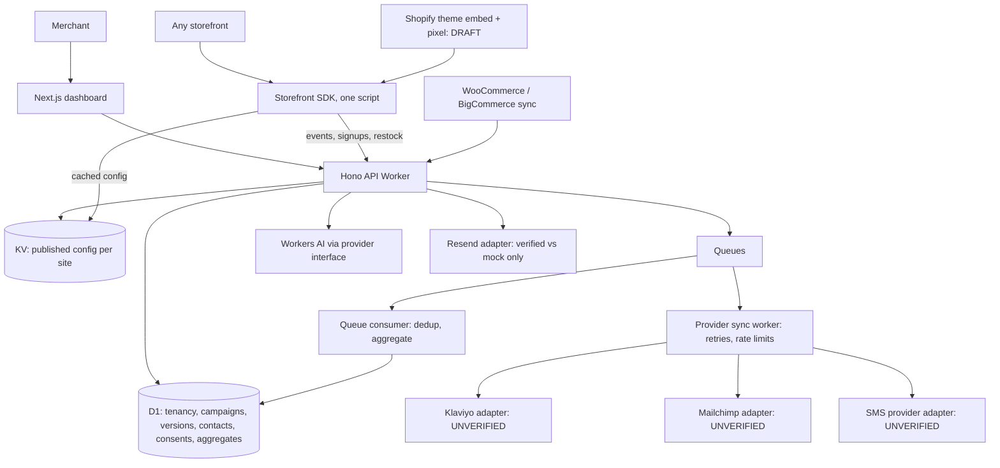

# ConvertFlow AI — Six-tool architecture (Phase 0 for the multi-tool expansion)

Written 2026-10-27 against the repository as it stands (200 tests green at the start of this work; see `docs/status.md`).
Anything marked **UNVERIFIED** has not been run against the real third party.

## 1. Where we start (what already exists)

| Spec capability | Exists today | Gap |
|---|---|---|
| Shared campaign model, immutable versions, rollback, approval guard, kill switch | Yes (`campaigns`, `campaign_versions`, publish/rollback) | None. Reuse as is. |
| Trigger + targeting engine | Yes: `immediate`, `delay`, `scroll_depth`, `exit_intent`, `idle`; 10 condition fields, one AND/OR level | Missing triggers: `page_view` is implicit, `add_to_cart`, `cart_updated`, `product_view` as a distinct trigger, schedule windows are date-only |
| Frequency, suppression | Per session / visitor, dismiss + click cooldown | Needs *cross-tool* cooldown (a dismissed toast must not be followed immediately by a signup popup) |
| Arbitration | `selectCampaign`: one winner by priority, "other_active" blocks | Needs **slots**: an interruptive slot (popup, signup), an ambient slot (toast), and passive surfaces (feed bell, inline recommendations) that can coexist |
| Formats | `popup`, `slide_in`, `announcement_bar`, `restock` | No toast, feed, recommendation, SMS or email signup formats |
| Subscribers / consent | `subscribers` is **restock-only** (product + email, double opt-in); `consent_records` has `analytics`, `marketing_email` | No unified contact model, no SMS, no per-channel consent log, no provider sync |
| Recommendations | Hand-picked product cards (title, link, image) | No relationship graph, no availability filter, no cart add, no frequently-bought-together |
| Analytics | Per-campaign daily aggregates, last-click attribution, holdout experiments, event dedup, queue consumer | Not split by tool; no per-tool metrics (feed opens, form submissions, recommendation add-to-carts) |
| AI studio | Workers AI adapter, policy validator, usage metering | Single campaign kind; must choose a tool and emit that tool's config |
| Billing | Stripe checkout/portal, plan limits | Plan entitlements per tool |
| Shopify | Webhook handler, draft theme embed/pixel | OAuth/billing/Admin API **not built and cannot be tested** (no Partner account) |

## 2. Architecture

One platform, six tools, one runtime. A **tool** is a configuration schema + a renderer + a metric set. Everything else is shared.



Not every interaction is synchronous: event ingestion is KV + queue only (D1 stays off the hot path, learned the hard way in load testing); subscriber provider sync is always queued and its status is shown as `pending` until it actually succeeds.

### Tool = schema + renderer + metrics

| Tool (display name is configurable) | `tool` key | Surface | Slot | Trigger types | Primary metrics |
|---|---|---|---|---|---|
| Notification feed | `feed` | Bell button + panel, persistent | passive | page load, schedule | opens, item clicks, unread |
| Toast popups | `toast` | Corner toast (non-blocking) | ambient | page view, delay, scroll, product view, collection view, add-to-cart, cart threshold, exit intent, schedule | impressions, dismissals, clicks |
| In-feed upsells | `upsell` | Inline / cart-drawer recommendation block | passive | page load, add-to-cart, cart change | impressions, product clicks, add-to-cart, revenue |
| SMS signup | `sms` | Popup / slide-in / inline / bar with phone field | interruptive | same as toast | impressions, submissions, opt-ins, sync failures |
| Email signup | `email` | Popup / slide-in / inline / bar with email field | interruptive | same as toast | impressions, submissions, opt-ins, double-opt-in confirms |
| Analytics | n/a | Dashboard only | n/a | n/a | everything above, per tool |

Existing `popup` / `slide_in` / `announcement_bar` / `restock` campaigns keep working unchanged: they are `tool: "toast"` (promotional) or `tool: "email"` (restock) by migration default, and the schema stays at `schemaVersion: 1` because every addition is optional.

### Arbitration (deterministic, in `packages/campaign-engine`)

Slots: `interruptive` (popup, signup forms), `ambient` (toast), `passive` (feed bell, inline recommendations).

Implemented in `packages/campaign-engine` (`selectExperiences`), with the slot classification in `packages/contracts/src/slots.ts` (zod-free, so the storefront bundle can import it).

1. Evaluate every campaign (schedule, targeting, frequency, suppression) exactly as today.
2. At most **one** `interruptive` and **one** `ambient` campaign win (highest priority, ties by id). `passive` surfaces are not limited to one: a feed shows many items and a page can hold several inline blocks, so all eligible passive campaigns are returned, best first.
3. `interruptive` and `ambient` are mutually exclusive on screen; interruptive wins if both are eligible at the same moment, whatever their priorities.
4. After any dismissal, a cross-tool **quiet period** (60 s, `QUIET_PERIOD_MS`) applies to `interruptive` and `ambient`; passive surfaces are unaffected. A toast that hides itself is *not* a dismissal and starts no quiet period.
5. A campaign that has been dismissed stays suppressed for its own configured days regardless of tool. Passive surfaces ignore impression caps and click cooldowns (a cap would make a feed item or inline form vanish after one view) but still honour dismissal.
6. A signup form is never shown to a visitor already known to be subscribed on that channel (restock forms are per product and exempt).
7. Passive surfaces never block and never take focus.
8. A free-shipping toast is only eligible when the cart is known and still short of the threshold.

**Known trade-off.** Arbitration is by eligibility, not by trigger timing. An eligible interruptive campaign that is still waiting for its trigger (for example exit intent) therefore suppresses a toast on the same page, even though it may never appear. This is the conservative choice (never two attention-takers) and is the first thing to revisit if merchants report toasts not showing.

## 3. Data model changes (migration plan)

Extend, do not fork. All tenant tables keep `store_id NOT NULL`.

**0002 — tool tagging.** `campaigns.tool` (default `toast`), index `(store_id, tool, status)`. Backfill: campaigns with `format = restock` become `email`.

**0003 — unified contacts and consent** (replaces per-tool subscriber tables; restock rows are migrated):

- `contacts`: `id`, `store_id`, `email` (lowercased, nullable), `phone_e164` (nullable), `first_name`, `created_at`. Unique `(store_id, email)` and `(store_id, phone_e164)` where not null. No other personal data. At least one of email/phone required.
- `contact_consents`: **append-only log**. `contact_id`, `store_id`, `channel` (`email|sms`), `purpose` (`marketing|restock_alert`), `event` (`requested|confirmed|revoked`), `consent_text_hash`, `consent_text_version`, `campaign_id`, `version_id` (the form that collected it), `occurred_at`. Current state is derived from the latest row per `(contact, channel, purpose)`. No IP address is stored (not needed to prove consent for our purposes; counsel may want it, flagged).
- `suppressions`: replaces `suppression_records`; keyed by `(store_id, channel, value_hash)` so a hard opt-out outlives contact deletion.
- `provider_connections`: `store_id`, `provider` (`klaviyo|mailchimp|sms_*`), encrypted credentials (same AES-GCM path as `integration_credentials`), `list_id`, `status`, `last_checked_at`, `last_error`.
- `provider_sync_jobs`: `contact_id`, `provider`, `channel`, `status` (`pending|synced|failed|skipped_no_consent|skipped_suppressed`), `attempts`, `next_attempt_at`, `provider_ref`, `last_error`. Unique `(contact_id, provider, channel)`. A job is only ever **created** when current consent is confirmed.

**0004 — feed.** `feed_items` (campaign-owned content is in the campaign version; this table only holds per-visitor state we are allowed to keep, which is none server-side: read state lives in the visitor's browser). So: **no table**. Feed read/unread is client-side by default; server-side read state would require an identifier we do not otherwise collect.

**0005 — recommendations.** `product_relationships` (`store_id`, `product_id`, `related_product_id`, `kind: complement|alternative|bundle`, `source: merchant|observed`, `weight`), `bundles` + `bundle_items`. Level-1 (merchant/tag/collection) only at first; "observed" requires order line items, which only platform webhooks provide.

**0006 — analytics by tool.** `analytics_aggregates` gains `tool`, plus generic `metric_counters(store_id, campaign_id, version_id, day, metric, value)` for tool-specific counters (feed opens, add-to-carts, form submissions, opt-ins) so new metrics do not need a column each.

## 4. Event contract (additions)

New `EventType`s (all optional extensions, schema stays v1): `feed_open`, `feed_item_click`, `recommendation_impression`, `recommendation_click`, `recommendation_add_to_cart`, `form_submit_attempt`, `form_submit_success`, `form_submit_failure`. Existing dedup (`store_id, event_id`), consent gate (`consent: true`), and queue path are reused. Form *submissions* (which carry personal data) never travel the analytics path: they go to a dedicated `/api/v1/subscribe` endpoint with its own validation, rate limit and Turnstile option; analytics only sees the anonymous event.

## 5. API additions

```
POST /api/v1/subscribe                  public (site key + origin), email|sms form submit -> contact + consent + queued sync
GET  /api/v1/subscribe/confirm          public, double opt-in link
GET  /api/v1/subscribe/unsubscribe      public, signed one-click token (existing pattern)
GET  /api/v1/subscribers                session, role >= editor, paginated, no export of unconsented
DELETE /api/v1/subscribers/:id          session, role >= admin (erasure; keeps hashed suppression)
GET/PUT /api/v1/providers/:provider     session, role >= admin (connect, health, list mapping, disconnect)
GET  /api/v1/recommendations            public (site key), deterministic, availability filtered
POST /api/v1/campaigns {tool,...}       existing route, validated per tool
GET  /api/v1/analytics/tools            session, per-tool rollups
```
Campaign CRUD, publish, rollback, generate and validate stay as the single shared set of routes; tool-specific rules are validated by a per-tool schema inside `validate`.

## 6. Decisions and honest constraints

1. **Names.** The working tool names in the brief (NotiFeed, NotiPop, NotiSell, NotiSMS, NotiEmail) are identical to a competing product's marketed names. They stay as configurable display strings (`NEXT_PUBLIC_TOOL_NAMES`), and code uses neutral keys (`feed`, `toast`, `upsell`, `sms`, `email`). **Rename before any public launch** and run a trademark search. This is the same class of problem as the product name itself (see `docs/status.md` blocker 9).
2. **Shopify** is one adapter among several. It cannot be tested without a Partner account. Nothing about the six tools depends on it.
3. **Providers (Klaviyo, Mailchimp, SMS)** are built behind one adapter interface with a recording fake used for tests. Their real APIs are **UNVERIFIED** until credentials exist; the dashboard must say "Not verified against the live provider" until a real connection check has passed. No SMS is ever *sent* by this platform: NotiSMS collects consent and syncs the subscriber to a provider that sends.
4. **Compliance wording** for SMS/email consent is a template. A lawyer must review it per target jurisdiction (TCPA, CASL, GDPR/ePrivacy). We store the exact text hash and version shown so consent is provable.
5. **Social proof** ("N people bought this") is intentionally **not built** until verified order data exists; the spec forbids fabrication and we have no verified source on non-Shopify stores.
6. **Recommendations** ship as deterministic Level 1 only. Level 2 needs order line items and enough volume; Level 3 (AI ranking) only after A/B variants exist. Not claimed in any plan until built.
7. **Rate limiting** remains per-isolate in app code; real limits belong in Cloudflare rules (deployment blocker, unchanged).
8. **Feed read state** is browser-local. This is deliberate for privacy. Cross-device read state would need an authenticated customer identity (Shopify customer account or a store-supplied id); not built.

## 7. Dependency-ordered backlog

Legend: **A** = buildable and fully testable here. **B** = buildable, but only fake-tested without external accounts.

| # | Work | Class | Depends on |
|---|---|---|---|
| 1 | Contracts: `tool`, toast formats/triggers, feed, recommendation, signup form schemas + tests | A | — |
| 2 | Engine: slots, cross-tool quiet period, new triggers/conditions + tests | A | 1 |
| 3 | Migration 0002 (tool tag) + API validation per tool + OpenAPI | A | 1 |
| 4 | SDK: toast renderer, cart/product triggers, multi-slot runtime, cleanup manager | A | 2 |
| 5 | Dashboard shell: per-tool pages + editors reusing the shared editor | A | 3 |
| 6 | **Toast tool end to end** (editor → publish → storefront → events → analytics), e2e | A | 3–5 |
| 7 | Feed: SDK bell/panel, local read state, editor, metrics, e2e | A | 6 |
| 8 | Contacts + consent migration, `/subscribe`, double opt-in, suppression, restock migration | A | 3 |
| 9 | Email + SMS forms (SDK + editors), subscriber management UI, erasure | A | 8 |
| 10 | Provider adapter interface + fake + Klaviyo + Mailchimp + SMS adapters, sync worker, retries | B | 8 |
| 11 | Upsell: relationships, deterministic recommender, availability filter, cart add via Shopify AJAX/Woo/generic | A (Shopify/Woo cart: B) | 6 |
| 12 | Metric counters + per-tool analytics + dashboards | A | 6, 7, 9, 11 |
| 13 | AI studio chooses tool, emits per-tool config, validated | A (live model: B) | 3 |
| 14 | Entitlements per tool in plans + backend enforcement | A | 3 |
| 15 | Privacy: data-request/erasure for contacts, retention jobs | A | 8 |
| 16 | Docs, security review, perf budget (SDK size), CI on Linux | A | all |

Live-account verification (Cloudflare deploy, Workers AI, Stripe, Resend, Klaviyo, Mailchimp, SMS provider, Shopify, Woo, BigCommerce) stays in `docs/status.md` "Launch blockers" and is not claimable until run.
